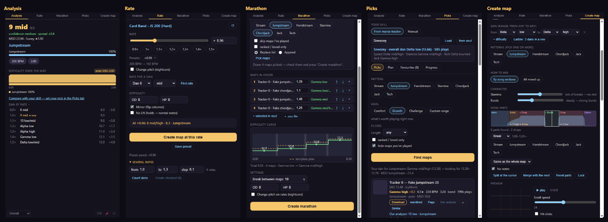

# Lunacy mania instrument

**English** · [Русский](README.ru.md)

**Lunacy mania** is a small always-on-top window for **osu!mania 4K rice** players. It shows the dan of the map you have selected in osu!, changes rates, builds marathons and dan courses, picks maps for your skill and can map a song for you.

[](https://github.com/kibuk12311/lunacy-mania-instrument/releases/latest)




## What it does

| Tab | What you get |
|---|---|
| **Analysis** | The dan of the selected map (Alpha…Kappa and the numbered dans below; past Kappa high it reads "above Kappa · 21.3"), how sure it is, the main patterns, MSD and Sunny ★. Pick the calculator: our combined one, Mixed, Daniel, Azusa, Roxy, Companella, or all of them side by side. A difficulty line along the map, patterns by part, "for you" (how the map compares with your skill) and a dan-by-rate ladder. DT and HT are taken into account. |
| **Rate** | Makes rate versions of a map next to the original (audio included, pitch kept or not). Finds the rate that puts a map at a target dan, does several rates at once, mirrors a chart or strips its LNs, and remembers presets. |
| **Marathon** | Joins maps into one marathon or dan course `.osz`, with breaks you choose. Course templates, an automatic marathon built from your skill profile, and a difficulty curve of the whole course. |
| **Picks** | Maps worth playing for your skill, by pattern and goal (comfort, growth, challenge) or your own dan range. Your skill comes from [mania-tracker](https://mania-tracker.com). One-click download, a training plan, similar maps, favourites exported as an osu! collection, and progress over time. |
| **Create** (Create map) | Maps a song for you: detects BPM and offset (also songs with several BPMs, 1/3 and 1/6 snaps), finds the song's parts and lets you give each part its own dan and patterns. Several variants, a preview player with a playfield, locking a part and regenerating the rest, a whole mapset or a dan ladder in one click, rate versions, metadata and background. It can also remap an existing map one dan up or down. |

The interface is in Russian and English (the RU/EN button under the card, or the tray menu).

## Download

Get it from the [latest release](https://github.com/kibuk12311/lunacy-mania-instrument/releases/latest):

- **`Lunacy-mania-Setup-<version>.exe`** — the installer. Installs for your Windows user only (no admin), adds Start menu and desktop shortcuts, and **updates itself**: when a new version is out it downloads it in the background and asks to restart.
- **`Lunacy-mania-Portable-<version>.exe`** — portable, nothing to install. It tells you when a new version is out and opens the download page.

The app isn't code-signed, so Windows may show "Windows protected your PC". Click **More info → Run anyway**.

**Needs:** Windows 10 or 11 (64-bit) and **osu! stable or osu! lazer** — or **[Interlude](https://github.com/YAVSRG/YAVSRG)** (portable, from 0.9.2; see below). The app reads the selected map through [tosu](https://github.com/tosuapp/tosu), which comes bundled and starts by itself (the footer shows which one it is connected to). Picks, downloads and update checks need the internet; everything else works offline.

**With Interlude** (0.9.2) — Interlude has no API that says what is selected or played in it, so the app works with its folder, and a small bundled helper, `interlude-reader.exe`, reads the running game the way tosu reads osu!:
- **Link the folder:** the **IL** button in the card's footer → «Pick folder…» (the folder with Interlude.exe, Songs and Data) or «Find». The app only reads Interlude's `Songs\charts.db` and `Data\scores.db`, from copies it makes in its own folder; nothing is ever written into `Songs`.
- **Analyse a chart:** search Interlude's library in the same panel (artist, title, difficulty) and click a chart: the card shows its dan, patterns, MSD and rates, and the Rate tab works on it (a copy with its audio goes to Documents\Lunacy mania\interlude).
- **Send maps to Interlude:** rate copies, marathons, generated maps, remaps and downloads get a «→ Interlude» button. Interlude can't be told to import a file from outside, so the app packs an .osz, shows it in Explorer and brings Interlude to the front (or starts it) — drag the .osz onto Interlude's window.
- **Playlists:** «Playlist in Interlude» adds a marathon list (each map at its rate), the Picks plan or your favourites to Interlude's `Data\collections.json` as a playlist. Interlude must be closed (it rewrites that file when it exits); the old file is kept as `collections.json.bak-<date>`, and maps not in your Interlude library yet are listed — import them first.
- **Played maps:** with the folder linked, Picks' «hide played» also hides osu! maps you played in Interlude.
- **Live card:** with «Follow Interlude live» on (the default once the folder is linked; the IL panel), the card shows the chart you select in Interlude at its rate, like osu!'s selection, and the footer reads **«Interlude · live»**. With osu! running too, whichever selection changed last has the card. A chart that isn't in the linked library yet (just imported) is shown by its name with a note.
- **Overlay:** the in-game overlay shows plays in Interlude: the judgements under the ruleset's own names (SC, Wife3, osu!mania…) with Interlude's accuracy, KPS and key lines from your real presses, UR from the hit deltas, the chart's NPS; a retry starts over, the score screen counts as the results.
- **How the reader works:** it only *reads* Interlude's memory (like dotnet-dump; no writing, no injection, no network). It needs a .NET helper file (`mscordaccore.dll`) matching Interlude's runtime; one ships with the app. If none fits, the panel says so — tick «Download .NET's helper file if it's missing» and it is fetched once from Microsoft's symbol server and kept. **Antivirus:** reading another program's memory can make a heuristic antivirus flag the unsigned `interlude-reader.exe`; it's in `resources\interlude-reader\` — add that folder to the exclusions if it gets removed (the panel then says the helper is missing). Run Interlude normally, not as administrator (the panel tells you if it can't open the process).
- **«Did Interlude update? The scanner didn't find …»:** a new Interlude version renamed something the reader looks for. The rest keeps working (pick charts in the IL panel as before); a new version of the app fixes it — report it with the line from the panel.

**On osu! lazer** a few things work differently, because lazer keeps its maps in its own file store instead of a Songs folder:
- **Rate**, **remap** and **«+ selected in osu!»** in Marathon work on a copy of the map in Documents\Lunacy mania\lazer; nothing is ever written into lazer's folder. Rate copies and remaps are packed into an .osz (in Documents\Lunacy mania\карты) and opened, so lazer imports them as a **separate beatmap set** (no F5 needed; if lazer doesn't open it, drag the .osz into its window).
- **Collections:** lazer can't take a collection.db. The export still writes one (for stable) and, with lazer connected, a list of the maps with links next to it, so you can add them to a collection in lazer yourself.
- Lazer's own speeds (DT/HT at any speed, Rate Adjust) are read as the rate everywhere, and the overlay's key lines use lazer's real key presses. Run lazer in **Borderless** or **Windowed** mode for the overlay. tosu downloads what it needs for each new lazer version by itself; right after a lazer update that can take a moment.

## How to use

1. Start osu! and the app, go to song select. The card shows the selected map's dan.
2. 📌 keeps the window on top, ▭ is the compact mode. Both are also in the tray icon's menu, next to the language and "Check for updates".
3. Rate copies made in the Rate tab are written next to the original map in your `Songs` folder (a new difficulty plus its sped-up audio), the way rate changers usually work; press F5 in song select to see them (on osu! lazer they come as an .osz instead, see above). Everything else the app makes (marathons, generated maps, downloads, collections) goes to `Documents\Lunacy mania` (if you have the folder of an older version, `Sneezey's dan calculator` or `Анализатор данов`, the app keeps using it), and finished `.osz` files are opened in osu! so the game imports them.

More detail for friends: [docs/for-friends.md](docs/for-friends.md).

## Profile

The **Profile** tab holds both profiles. **mania-tracker**: your tracker player (dan, the four tiles, MinaCalc ratings, history chart, recent plays, a link to the site). **My profile** is learnt from your own plays, offline: plays that reach the results screen in osu! stable or lazer are recorded (through tosu), and your history can be imported once from osu! stable's `scores.db` (matched to your `Songs` folder) and from Interlude. Each play gets a performance dan (the map's dan at its rate, adjusted for accuracy, full at 96.5%), attributed to Speed / Jack / Stamina / Tech and the seven patterns by the map's pattern shares; each is the weighted mean of your best 20 maps, with a ± range and a confidence, and the overall dan is the mean of the four axes. Choose it as the source in Picks and it drives picks, the plan, the auto-marathon and "for you". It's stored in the app's user data folder; export, import and reset are on the page. osu! lazer's past plays can't be read. How it works: [docs/local-profile.md](docs/local-profile.md).

## Generated maps and osu! rules

Maps from the Create map tab are made by a trained model, so they are **for practice and local play**. osu!'s [Ranking Criteria](https://osu.ppy.sh/wiki/en/Ranking_criteria) require hit objects, hitsounds and timing to come from direct human input, so AI-made maps can't be ranked or loved. Local plays have no leaderboard or pp, and neither do rate copies or marathons. If you upload a generated map anywhere, say it was made with AI. Rate copies and marathons of other people's maps are for yourself; uploading them needs the mappers' and artists' permission.

## Privacy

No account and no telemetry. The app only talks to: mania-tracker (your skill and played maps, when you load a profile), the beatmap mirrors osu.direct, Sayobot and BeatConnect (downloads), osu.ppy.sh (map pages and `.osu` files) and GitHub (update checks) — plus, only if you turn on «Download .NET's helper file if it's missing», Microsoft's symbol server once for the Interlude reader. Your settings stay on your PC.

## Building from source

Needs Windows, [Node.js](https://nodejs.org) 22 or newer and git.

```bash
git clone https://github.com/kibuk12311/lunacy-mania-instrument.git
cd lunacy-mania-instrument
npm ci
node tools/fetch-tosu.mjs
npm start
```

- `node tools/fetch-tosu.mjs` downloads the pinned tosu release into `vendor/tosu/` and checks its sha256.
- The trained map generator `models/mapper.json` (~37 MB) is not in git. Download `mapper.json` from a release into `models/`; without it the generator runs in its rule-based mode.
- The generator picks the first model that loads and fits the request (`app/generatorJobs.js`): the neural `mapper-nn2-{l,m,s}.json` sizes (on "auto", L and M only with a GPU path; the distilled `mapper-nn2-s-distilled.json` before the plain S), then `mapper-xgb3.json`, `mapper-nn.json`, `mapper.json`. A model that needs the song's stems is skipped without them. `critic.json` is optional.
- For development, set `LUNACY_MODEL_DIR` to folders to read models from before `models/` (joined by `;`), for example `set LUNACY_MODEL_DIR=A:\SneezeyTrain\candidates;A:\SneezeyTrain\critic` before `npm start`. Nothing is copied; unset it to go back to the shipped models.
- With a WebGPU adapter, the neural models' encoder runs on the GPU in a hidden window (`app/gpuWorker*`, `src/gen/nn/webgpu/`); the decoder and the sampling stay on the CPU, and without a GPU, or when the GPU fails its parity probe, everything runs on the CPU. `npx electron tests/smoke/electron-webgpu.mjs` checks the GPU kernels against PyTorch and the JS path, `npx electron tests/smoke/electron-gpu-link.mjs` checks the worker-to-GPU link, and `npx electron tools/bench-gpu.mjs` times both paths (numbers in `docs/2026-10-26-webgpu-stream-w.md`).
- `npm test` runs the tests (Node's built-in test runner).
- `npm run build:reader` builds the Interlude reader (`native/interlude-reader`, C# with [ClrMD](https://github.com/microsoft/clrmd); needs the .NET 8 SDK) into `native/interlude-reader/out/reader/`: `interlude-reader.exe` and a bundled .NET DAC. `npm start` runs it from there, the release build ships it as `resources\interlude-reader\`. Build it before `npm run dist` (the build refuses to pack without it). Its own tests: `powershell -File native/interlude-reader/build.ps1` (with the fake Interlude) and `node native/interlude-reader/test.mjs`; `node tools/record-interlude-lines.mjs` records its lines into `tests/fixtures/` for the app's tests, and `npx electron tests/smoke/electron-interlude.mjs <out> --live` / `npx electron tests/smoke/electron-overlay.mjs <out> --interlude` run the app against the fake game.
- `npm run dist` builds the installer, the portable exe and `latest.yml` into `dist/`.


### Project layout

```
app/        Electron main process, IPC per tab, workers, renderer (app/renderer)
src/        the logic: core (analysis), rate, recommend, gen (map generator), audio, analysis, i18n
vendor/     LeoBlack's ManiaMapAnalyser (dan estimators, pattern finder, MinaCalc, Sunny)
models/     dan model and the generator's learned mapper
tools/      data fetchers, dataset builders, training (Python) and evaluation scripts
tests/      unit tests, fixtures and Electron smoke scripts (tests/smoke)
docs/       design notes and plans
```

### Training the generator

The learned mapper is trained on community 4K charts (ranked and loved osu! maps, EtternaOnline packs, Malody converts, dan course packs). The pipeline is in `tools/`: `fetch-*.mjs` collect charts, `build-mapper-dataset.mjs` turns them into training rows, `train_mapper.py` trains the model (`pip install -r tools/requirements.txt`), and `eval-generator.mjs`, `eval-timing.mjs` and `eval-parts.mjs` measure it on held-out songs. The charts themselves are not part of this repository.

## Credits

- Dan estimators, pattern finder and Sunny star rating: [ManiaMapAnalyser](https://github.com/LeoBlackMT/osumania_map_analyser) by Leo_Black (MIT).
- MSD: MinaCalc from [Etterna](https://github.com/etternagame/etterna).
- Reading osu!: [tosu](https://github.com/tosuapp/tosu). Reading Interlude: [ClrMD](https://github.com/microsoft/clrmd) (MIT) and the .NET runtime's DAC (MIT).
- Interlude formats: read from [Prelude](https://github.com/YAVSRG/YAVSRG) by Percyqaz (MIT), re-implemented.
- Player skill and map dans: [mania-tracker](https://mania-tracker.com).
- Audio: [FFmpeg](https://ffmpeg.org).

Full list and licenses: [THIRD_PARTY_NOTICES.md](THIRD_PARTY_NOTICES.md).

## License

[MIT](LICENSE) © 2026 Sneezey. Bundled third-party programs keep their own licenses.
