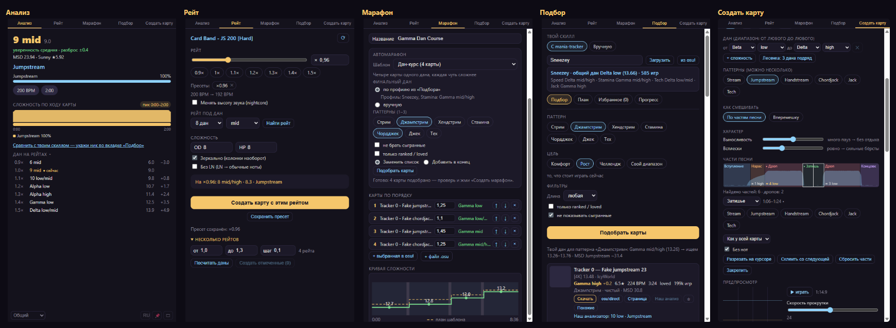

# Lunacy mania instrument

[English](README.md) · **Русский**

**Lunacy mania** — небольшое окно поверх игры для тех, кто играет **osu!mania 4K rice**. Показывает дан карты, выбранной в osu!, делает рейты, собирает марафоны и дан-курсы, подбирает карты под твой скилл и может сам замапить песню.

[](https://github.com/kibuk12311/lunacy-mania-instrument/releases/latest)




## Что умеет

| Вкладка | Что даёт |
|---|---|
| **Анализ** | Дан выбранной карты (Alpha…Kappa и номерные даны ниже; выше Kappa high — «выше Kappa · 21.3»), насколько он уверен, главные паттерны, MSD и Sunny ★. Можно выбрать калькулятор: наш общий, Mixed, Daniel, Azusa, Roxy, Companella или все сразу. Линия сложности по карте, паттерны по частям, **дан по частям** (каждая часть карты посчитана моделью дана как отдельная карта, ступеньки по времени, самая сложная часть отмечена), «для тебя» (как карта соотносится с твоим скиллом) и лесенка данов по рейтам. DT и HT учитываются. |
| **Рейт** | Делает рейт-версии карты рядом с оригиналом (вместе с аудио, с сохранением тона или без). Находит рейт под нужный дан, делает несколько рейтов сразу, отзеркаливает карту или убирает LN, запоминает пресеты. |
| **Марафон** | Склеивает карты в один марафон или дан-курс `.osz` с перерывами, какие захочешь. Шаблоны курсов, авто-марафон по твоему профилю и кривая сложности всего курса. |
| **Подбор** | Карты, которые стоит сыграть под твой скилл: по паттерну и цели (комфорт, рост, вызов) или по своему диапазону данов. Скилл берётся с [mania-tracker](https://mania-tracker.com). Скачивание в один клик, план тренировки, похожие карты, избранное с выгрузкой в коллекцию osu! и прогресс. |
| **Создать** (создать карту) | Мапит песню: находит BPM и оффсет (в том числе у песен с несколькими BPM, снапы 1/3 и 1/6), делит песню на части, и каждой части можно дать свой дан и паттерны. Несколько вариантов, плеер с превью игрового поля, закрепить часть и перегенерировать остальное, целый мапсет или лесенка данов в один клик, рейт-версии, метаданные и фон. Ещё умеет перемапить готовую карту на дан выше или ниже. |
| **Скин** | Редактор и конструктор скинов osu!mania 4K: открой свой скин osu! (копией), `.osk` или сделай с нуля (форма нот, цвета колонок, клавиши, LN, сцена, оценки, подсветка — всё рисует приложение, @1x и @2x). Правь значения [Mania] 4K и картинки с живым предпросмотром игрового поля, отмена / повтор, и сохраняй `.osk`, который импортируют osu! stable и lazer; скин с нуля выгружается и для Interlude. |

Интерфейс на русском и английском (на странице настроек — ⚙ под карточкой — или в меню трея).

## Скачать

Бери в [последнем релизе](https://github.com/kibuk12311/lunacy-mania-instrument/releases/latest):

- **`Lunacy-mania-Setup-<версия>.exe`** — установщик. Ставится только для твоего пользователя Windows (без прав администратора), создаёт ярлыки в «Пуске» и на рабочем столе и **обновляется сам**: когда выходит новая версия, тихо скачивает её и предлагает перезапуститься.
- **`Lunacy-mania-Portable-<версия>.exe`** — портативная версия, ставить не нужно. Сообщает о новой версии и открывает страницу загрузки.

У приложения нет цифровой подписи, поэтому Windows может показать «Система Windows защитила ваш компьютер». Нажми **Подробнее → Выполнить в любом случае**.

**Нужно:** Windows 10 или 11 (64-бит) и **osu! stable или osu! lazer** — или **[Interlude](https://github.com/YAVSRG/YAVSRG)** (портативный, с 0.9.2; см. ниже). Выбранную карту приложение читает через [tosu](https://github.com/tosuapp/tosu) — он уже внутри и запускается сам (внизу окна видно, к какому osu! он подключился). Подбору, скачиванию и проверке обновлений нужен интернет, остальное работает без него.

**С Interlude** (0.9.2) — Interlude не сообщает наружу, что в нём выбрано или играется, поэтому приложение работает с его папкой, а запущенную игру читает маленький встроенный помощник `interlude-reader.exe` — так же, как tosu читает osu!:
- **Подключи папку:** кнопка **IL** внизу карточки → «Выбрать папку…» (та, где Interlude.exe, Songs и Data) или «Найти». Приложение только читает `Songs\charts.db` и `Data\scores.db` Interlude — из копий в своей папке; в `Songs` ничего не пишется.
- **Анализ карты:** в той же панели ищи по библиотеке Interlude (исполнитель, название, сложность) и нажми на карту — карточка покажет дан, паттерны, MSD и рейты, а вкладка «Рейт» будет работать с ней (копия с аудио кладётся в Документы\Lunacy mania\interlude).
- **Отправить карту в Interlude:** у рейт-копий, марафонов, созданных карт, ремапов и скачанного есть кнопка «→ Interlude». Снаружи Interlude нельзя попросить импортировать файл, поэтому приложение собирает .osz, показывает его в Проводнике и выводит Interlude вперёд (или запускает) — перетащи .osz в окно Interlude.
- **Плейлисты:** «Плейлист в Interlude» добавляет список марафона (каждая карта со своим рейтом), план из «Подбора» или избранное плейлистом в `Data\collections.json` Interlude. Interlude должен быть закрыт (при выходе он перезаписывает этот файл); старый файл сохраняется как `collections.json.bak-<дата>`, а карты, которых ещё нет в библиотеке Interlude, перечисляются — сначала импортируй их.
- **Сыгранные карты:** с подключённой папкой «Скрыть сыгранные» в «Подборе» прячет и карты osu!, сыгранные в Interlude.
- **Карточка вживую:** пока включено «Следить за Interlude вживую» (по умолчанию — как только папка подключена; в панели IL), карточка показывает карту, выбранную в Interlude, с её рейтом — как выбор в osu!, а внизу написано **«Interlude · live»**. Если запущен и osu!, карточка за тем, где выбор менялся последним. Карта, которой ещё нет в подключённой библиотеке (только что импортирована), показывается по названию с пояснением.
- **Оверлей:** оверлей в игре показывает игру в Interlude: попадания под названиями самого рулсета (SC, Wife3, osu!mania…) и точность Interlude, KPS и линии клавиш по настоящим нажатиям, UR по отклонениям, NPS карты; рестарт начинает заново, экран счёта — это результаты.
- **Как работает помощник:** он только *читает* память Interlude (как dotnet-dump; ничего не пишет, ничего не внедряет, в сеть не ходит). Ему нужен служебный файл .NET (`mscordaccore.dll`) под версию Interlude; один лежит в комплекте. Если не подошёл, панель скажет — включи «Скачать служебный файл .NET, если его нет», и он один раз скачается с сервера символов Microsoft и сохранится. **Антивирус:** чтение памяти другой программы может насторожить эвристику антивируса — `interlude-reader.exe` не подписан; он лежит в `resources\interlude-reader\` — добавь папку в исключения, если его удалят (тогда панель напишет, что помощника нет). Запускай Interlude обычным образом, не от администратора (иначе панель скажет, что нет доступа к процессу).
- **«Interlude обновился? Сканер не нашёл …»:** в новой версии Interlude переименовали что-то, что ищет помощник. Остальное работает (карты можно выбирать в панели IL, как раньше); исправит новая версия приложения — пришли строку из панели.

**С osu! lazer** кое-что работает иначе: lazer хранит карты в своём хранилище, а не в папке Songs:
- **Рейт**, **ремап** и «**+ выбранная в osu!**» в марафоне работают с копией карты в Документы\Lunacy mania\lazer; в папку lazer ничего не пишется. Рейт-копии и ремапы собираются в .osz (в Документы\Lunacy mania\карты) и открываются — lazer импортирует их **отдельным набором** (F5 не нужен; если lazer не открыл файл, перетащи .osz в его окно).
- **Коллекции:** collection.db в lazer не добавить. Экспорт всё равно пишет его (для stable), а с lazer рядом сохраняется список карт со ссылками — их можно добавить в коллекцию в самом lazer.
- Свои скорости lazer (DT/HT с любой скоростью, Rate Adjust) везде читаются как рейт, а линии нажатий в оверлее берут настоящие нажатия из lazer. Для оверлея запускай lazer в режиме **Borderless** или **Windowed**. Данные под новую версию lazer tosu скачивает сам; сразу после обновления lazer это может занять немного времени.

## Как пользоваться

1. Запусти osu! и приложение, зайди в выбор песен. Карточка покажет дан выбранной карты.
2. **⚙** под карточкой открывает страницу **«Настройки»** (или «Настройки…» в трее): калькулятор, язык, 📌 поверх всех окон, оверлей, Interlude, источник профиля и «Записывать мои игры», папки, обновления, osu!/tosu, кэш и «О программе». 📌, язык и «Проверить обновления» есть и в меню значка в трее. (Компактного режима с 0.9.6 нет — его работу делает оверлей в игре.)
3. Всё, что делает приложение (марафоны, созданные карты, скачанное, коллекции), лежит в `Документы\Lunacy mania`. Исключение — рейты из вкладки «Рейт»: их копии (новая сложность и ускоренное аудио) кладутся рядом с оригинальной картой в папке `Songs`, как это обычно делают рейт-ченджеры; нажми F5 в выборе песен, чтобы их увидеть (в osu! lazer — .osz-файлом, см. выше). Остальные готовые `.osz` приложение открывает в osu!, и игра импортирует их сама.

## Оверлей в игре

Маленькие отдельные окошки поверх игры (в игру ничего не встраивается; osu! в оконном или безрамочном режиме), клики проходят сквозь них во время игры; для osu! stable, lazer и Interlude: **Попадания** (счёт, MAX:300, точность, UR), **KPS** (сейчас, максимум, график за 10 с), **NPS карты** (плотность карты у позиции игры, пик, вся карта с бегунком), **Линии нажатий** (нажатия по колонкам) и **Дан**. Они видны, пока идёт игра (и на экране результатов, если включено), в пяти стилях (Минимал, Карточка, Неон, Классика osu!, Компакт), у каждого своя видимость, размер и место; Ctrl+Shift+O (или трей, или страница настроек) — двигать. Включаются в меню трея «Оверлей», в блоке оверлея на странице **«Настройки»** (⚙ под карточкой) или в окне настроек оверлея.

**Дан** показывает общий дан карты на рейте игры — ту же оценку, что на карточке, число и название (например «13.0 Gamma mid», выше Kappa high — «выше Kappa»), и сразу после установки больше ничего. По желанию (выключено, пока не включишь в настройках оверлея): главный паттерн и уверенность, «+0.8 к твоему уровню» по профилю, выбранному в «Подборе» (mania-tracker, вручную или «Мой профиль»), а на экране результатов — «эта игра: …», дан твоей игры по модели «Моего профиля» (если запись игр включена). Окошко по высоте ровно под свои строки. Дан каждой части карты — во вкладке «Анализ» («Дан по частям»), не в оверлее. Карта считается один раз на карту и рейт (результат карточки, если она её показывала; иначе файл карты из tosu или чарт из библиотеки Interlude), не во время игры; до того написано «считаем…», а для не-4K, LN- и не-mania-карт так и написано.

## Профиль

Во вкладке **«Профиль»** оба профиля. **mania-tracker**: твой игрок на трекере (дан, четыре оси, рейтинги MinaCalc, график, последние игры, ссылка на сайт). **«Мой профиль»** приложение собирает само по твоим играм, без интернета: игры, дошедшие до экрана результатов в osu! stable или lazer, записываются (через tosu), а историю можно один раз импортировать из `scores.db` osu! stable (карты находятся в твоей папке `Songs`) и из Interlude. Каждая игра получает «дан игры» (дан карты на её рейте с поправкой на точность, полный при 96.5%) и засчитывается в Speed / Jack / Stamina / Tech и семь паттернов по долям паттернов карты; каждая ось — взвешенное среднее лучших 20 карт, с ± и уверенностью, а общий дан — среднее четырёх осей. Выбери его источником в «Подборе» — и подбор, план, авто-марафон и «для тебя» возьмут его. Хранится в папке данных приложения; экспорт, импорт и сброс — на той же странице. Прошлые игры osu! lazer импортируются из копии его базы («Импорт из osu! lazer»; сам lazer только читается). Как это устроено: [docs/local-profile.md](docs/local-profile.md).

## Скин

Вкладка **«Скин»** правит 4K-часть скина osu!mania — раздел `[Mania]` с `Keys: 4` в `skin.ini` — и делает новые 4K-скины. Скины из папки `Skins` osu! сначала копируются в рабочую копию (папка только читается); `.osk` / `.zip` распаковываются так же. Всё остальное в `skin.ini` (другие разделы, другие раскладки, комментарии, пробелы, кодировка, переводы строк) сохраняется как было. Поддерживаются все 4K-ключи из вики osu! (ColumnStart, ColumnWidth, HitPosition, Colour#, KeyImage#, NoteImage#H/L/T, StageHint, LightingN/L, Hit300g… — полный список в английском README) и [General] Name и Author. Любую картинку (ноты, части LN, клавиши, сцену, подсветку, оценки) можно заменить своей PNG, JPG или WebP: щёлкни по миниатюре или перетащи на неё файл; она сохранится в PNG в обычном размере и @2x, рядом — «Сбросить» и «Применить ко всем колонкам». Сохранение — в `Документы\Lunacy mania\скины`: `.osk` (открывается, и osu! его импортирует) или копия папкой.

Для **Interlude** — свой пакет `.isk`, только для скинов, сделанных с нуля (готовый скин osu! Interlude импортирует и правит сам). Твои картинки тоже попадают туда (вписанными в квадратные кадры Interlude). Переносится: картинки нот, начала/тела/конца LN и ресепторов по колонкам, цвета колонок, ширина колонок (×1080/480) и промежутки, цвет дорожек, подсветка колонок, вспышки попаданий, края сцены и линия удара. Не переносится: картинки клавиш (у Interlude ресепторы), позиция линии удара и направление скролла (настройки самого Interlude), картинки оценок (они в HUD и правилах Interlude), ScorePosition / ComboPosition / LightPosition. Перетащи `.isk` в окно Interlude, чтобы поставить скин.

## Созданные карты и правила osu!

Карты из вкладки «Создать карту» делает обученная модель, поэтому они **для практики и игры у себя**. По [критериям ранкинга](https://osu.ppy.sh/wiki/en/Ranking_criteria) ноты, хитсаунды и тайминг должен сделать человек, так что ИИ-карты нельзя ранкнуть или отправить в Loved. У карт, сыгранных только у себя, нет таблицы рекордов и pp, как и у рейтов и марафонов. Если выкладываешь созданную карту куда-то, напиши, что её сделал ИИ. Рейты и марафоны из чужих карт — для себя; чтобы их залить, нужно разрешение мапперов и авторов музыки.

## Приватность

Без аккаунта и без телеметрии. Приложение обращается только к mania-tracker (твой скилл и сыгранные карты, когда загружаешь профиль), зеркалам карт osu.direct, Sayobot и BeatConnect (скачивание), osu.ppy.sh (страницы карт и `.osu`) и GitHub (проверка обновлений), а помощник для Interlude — к серверу символов Microsoft, один раз и только если включено «Скачать служебный файл .NET, если его нет». Настройки хранятся у тебя на компьютере.

## Сборка из исходников

Нужны Windows, [Node.js](https://nodejs.org) 22 или новее и git.

```bash
git clone https://github.com/kibuk12311/lunacy-mania-instrument.git
cd lunacy-mania-instrument
npm ci
node tools/fetch-tosu.mjs
npm start
```

- `node tools/fetch-tosu.mjs` скачивает закреплённую версию tosu в `vendor/tosu/` и проверяет её sha256.
- Обученного генератора `models/mapper.json` (~37 МБ) нет в git. Скачай `mapper.json` из релиза в `models/`; без него генератор работает по правилам.
- Если есть видеокарта с WebGPU, энкодер нейросетевых моделей считается на ней в скрытом окне (`app/gpuWorker*`, `src/gen/nn/webgpu/`); декодер и выбор нот остаются на процессоре, а без видеокарты или если она не прошла проверку точности всё считается на процессоре. Проверки: `npx electron tests/smoke/electron-webgpu.mjs` (ядра на видеокарте против PyTorch и JS), `npx electron tests/smoke/electron-gpu-link.mjs` (связь воркера с видеокартой), замер скорости: `npx electron tools/bench-gpu.mjs` (цифры в `docs/2026-10-26-webgpu-stream-w.md`).
- `npm test` — тесты (встроенный в Node раннер).
- `npm run build:reader` — собирает помощника для Interlude (`native/interlude-reader`, C# на [ClrMD](https://github.com/microsoft/clrmd); нужен .NET 8 SDK) в `native/interlude-reader/out/reader/`: `interlude-reader.exe` и служебный файл .NET (DAC). `npm start` берёт его оттуда, релизная сборка кладёт в `resources\interlude-reader\`. Собери его до `npm run dist` (без него сборка не пакуется). Его собственные тесты: `powershell -File native/interlude-reader/build.ps1` (с поддельным Interlude) и `node native/interlude-reader/test.mjs`; `node tools/record-interlude-lines.mjs` записывает его строки в `tests/fixtures/` для тестов приложения, а `npx electron tests/smoke/electron-interlude.mjs <папка> --live` и `npx electron tests/smoke/electron-overlay.mjs <папка> --interlude` гоняют приложение с поддельной игрой.
- `npm run dist` — собирает установщик, портативный exe и `latest.yml` в `dist/`.


### Что где лежит

```
app/        главный процесс Electron, IPC по вкладкам, воркеры, интерфейс (app/renderer)
src/        логика: core (анализ), rate, recommend, gen (генератор карт), audio, analysis, skin (skin.ini, конструктор, Interlude), i18n
vendor/     ManiaMapAnalyser от LeoBlack (дан-калькуляторы, поиск паттернов, MinaCalc, Sunny)
models/     модель данов и обученный генератор
tools/      сбор данных, сборка датасета, обучение (Python) и оценка
tests/      тесты, фикстуры и смоук-скрипты Electron (tests/smoke)
docs/       заметки по устройству и планы
```

### Обучение генератора

Генератор учится на 4K-картах сообщества (ranked и loved карты osu!, паки EtternaOnline, конверты Malody, паки дан-курсов). Всё нужное лежит в `tools/`: `fetch-*.mjs` собирают карты, `build-mapper-dataset.mjs` превращает их в строки для обучения, `train_mapper.py` обучает модель (`pip install -r tools/requirements.txt`), а `eval-generator.mjs`, `eval-timing.mjs` и `eval-parts.mjs` проверяют её на отложенных песнях. Сами карты в репозиторий не входят.

## Благодарности

- Дан-калькуляторы, поиск паттернов и Sunny star rating: [ManiaMapAnalyser](https://github.com/LeoBlackMT/osumania_map_analyser) от Leo_Black (MIT).
- MSD: MinaCalc из [Etterna](https://github.com/etternagame/etterna).
- Чтение osu!: [tosu](https://github.com/tosuapp/tosu). Чтение Interlude: [ClrMD](https://github.com/microsoft/clrmd) (MIT) и DAC среды .NET (MIT).
- Форматы Interlude: по исходникам [Prelude](https://github.com/YAVSRG/YAVSRG) от Percyqaz (MIT), своя реализация.
- Скилл игроков и даны карт: [mania-tracker](https://mania-tracker.com).
- Звук: [FFmpeg](https://ffmpeg.org).

Полный список и лицензии: [THIRD_PARTY_NOTICES.md](THIRD_PARTY_NOTICES.md).

## Лицензия

[MIT](LICENSE) © 2026 Sneezey. Сторонние программы в сборке остаются под своими лицензиями.

Автор: Sneezey · Discord: sneezey123
